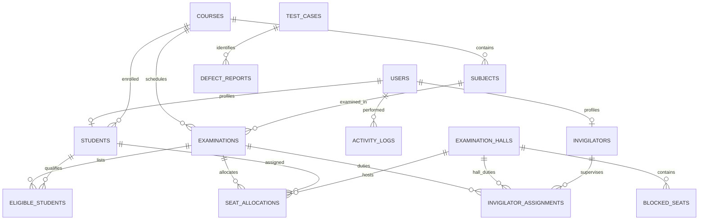

# ParikshaVinyas (परीक्षाविन्यास) — Relational Database Schema Documentation

**Database Management System:** SQLite via SQLAlchemy ORM  
**Application:** Smart Examination Hall & Seat Allocation Management System  
**Version:** 1.0.0 (STQA Academic Mini-Project)

---

## 1. Entity-Relationship Diagram

---

## 2. Table Specifications

### 2.1 Table: `users`
Stores credentials and role assignments for system authentication.

| Column | Type | Constraints | Description |
|---|---|---|---|
| `id` | INTEGER | PRIMARY KEY AUTOINCREMENT | Unique user identifier |
| `username` | VARCHAR(80) | UNIQUE, NOT NULL, INDEX | Login username or student enrollment number |
| `email` | VARCHAR(120) | UNIQUE, NOT NULL, INDEX | User contact email |
| `password_hash` | VARCHAR(255) | NOT NULL | Werkzeug scrypt/pbkdf2 salted password hash |
| `role` | VARCHAR(20) | NOT NULL, DEFAULT 'student' | Role: `admin`, `invigilator`, `student` |
| `is_active` | BOOLEAN | NOT NULL, DEFAULT TRUE | Account state |
| `created_at` | DATETIME | NOT NULL | Account creation timestamp |
| `last_login` | DATETIME | NULLABLE | Most recent authenticated session timestamp |

---

### 2.2 Table: `students`
Stores academic profile, degree enrollment, and class division.

| Column | Type | Constraints | Description |
|---|---|---|---|
| `id` | INTEGER | PRIMARY KEY AUTOINCREMENT | Unique candidate identifier |
| `user_id` | INTEGER | FOREIGN KEY (`users.id`), UNIQUE, NULLABLE | Linked authentication account |
| `enrollment_no` | VARCHAR(30) | UNIQUE, NOT NULL, INDEX | Institutional roll / enrollment code |
| `full_name` | VARCHAR(120) | NOT NULL | Full name of the candidate |
| `email` | VARCHAR(120) | NOT NULL, INDEX | Institutional email |
| `mobile` | VARCHAR(20) | NOT NULL | Mobile telephone number |
| `course_id` | INTEGER | FOREIGN KEY (`courses.id`), NOT NULL | Enrolled degree program |
| `branch` | VARCHAR(80) | NOT NULL | Engineering discipline |
| `semester` | INTEGER | NOT NULL | Current semester (1 to 8) |
| `division` | VARCHAR(10) | NOT NULL | Section / Division (A, B, C) |
| `academic_year`| VARCHAR(20) | NOT NULL, DEFAULT '2025-2026' | Current active session |
| `status` | VARCHAR(20) | NOT NULL, DEFAULT 'Active' | `Active`, `Detained`, `Inactive` |
| `created_at` | DATETIME | NOT NULL | Registration timestamp |

---

### 2.3 Table: `courses` & `subjects`
Stores academic degrees and curricula.

- **`courses`**: `id`, `code` (UNIQUE), `name`, `department`, `total_semesters`, `created_at`
- **`subjects`**: `id`, `code` (UNIQUE), `name`, `course_id` (FK), `semester`, `credits`, `academic_year`

---

### 2.4 Table: `examination_halls`
Stores physical examination halls and capacity dimensions.

| Column | Type | Constraints | Description |
|---|---|---|---|
| `id` | INTEGER | PRIMARY KEY AUTOINCREMENT | Unique hall identifier |
| `hall_code` | VARCHAR(30) | UNIQUE, NOT NULL, INDEX | Hall room code (e.g., `H-101`) |
| `hall_name` | VARCHAR(100) | NOT NULL | Hall title |
| `building` | VARCHAR(100) | NOT NULL | Campus complex / wing |
| `floor` | VARCHAR(20) | NOT NULL | Floor level |
| `num_rows` | INTEGER | NOT NULL | Number of horizontal desk rows |
| `num_cols` | INTEGER | NOT NULL | Number of vertical desk columns |
| `total_capacity`| INTEGER | NOT NULL | Computed as `num_rows * num_cols` |
| `status` | VARCHAR(20) | NOT NULL, DEFAULT 'Active' | `Active`, `Maintenance`, `Inactive` |

---

### 2.5 Table: `blocked_seats`
Tracks specific physically damaged, reserved, or obstructed desks.

| Column | Type | Constraints | Description |
|---|---|---|---|
| `id` | INTEGER | PRIMARY KEY AUTOINCREMENT | Unique block identifier |
| `hall_id` | INTEGER | FOREIGN KEY (`examination_halls.id`), NOT NULL | Target hall |
| `row_num` | INTEGER | NOT NULL | Row coordinate |
| `col_num` | INTEGER | NOT NULL | Column coordinate |
| `seat_identifier`| VARCHAR(20) | NOT NULL | e.g. `H-101-R01-C03` |
| `reason` | VARCHAR(200)| NULLABLE | Fault description / justification |
| `blocked_at` | DATETIME | NOT NULL | Timestamp |

- **Unique Constraint:** `uq_hall_row_col_blocked` on `(hall_id, row_num, col_num)`

---

### 2.6 Table: `examinations` & `eligible_students`
Tracks timetabled examination events and candidate eligibility.

- **`examinations`**: `id`, `exam_code` (UNIQUE), `exam_name`, `subject_id` (FK), `course_id` (FK), `semester`, `exam_date`, `start_time`, `end_time`, `duration_minutes`, `exam_type`, `academic_year`, `status`
- **`eligible_students`**: `id`, `examination_id` (FK), `student_id` (FK). Unique: `(examination_id, student_id)`

---

### 2.7 Table: `seat_allocations`
Core table for all physical seat assignments.

| Column | Type | Constraints | Description |
|---|---|---|---|
| `id` | INTEGER | PRIMARY KEY AUTOINCREMENT | Unique allocation ID |
| `examination_id` | INTEGER | FOREIGN KEY (`examinations.id`), NOT NULL | Target examination |
| `student_id` | INTEGER | FOREIGN KEY (`students.id`), NOT NULL | Assigned student |
| `hall_id` | INTEGER | FOREIGN KEY (`examination_halls.id`), NOT NULL | Assigned hall |
| `row_num` | INTEGER | NOT NULL | Desk row coordinate |
| `col_num` | INTEGER | NOT NULL | Desk column coordinate |
| `seat_identifier`| VARCHAR(25) | NOT NULL | Formatted seat code (e.g. `H-101-R01-C01`) |
| `strategy_used` | VARCHAR(50) | NOT NULL | `Sequential`, `Mixed Course`, `Random`, `Manual` |
| `allocated_at` | DATETIME | NOT NULL | Assignment timestamp |
| `allocated_by_id`| INTEGER | FOREIGN KEY (`users.id`), NULLABLE | Staff user who ran allocation |

- **Critical Constraint 1:** `uq_exam_student_seat` on `(examination_id, student_id)` — One student cannot have 2 seats in the same exam.
- **Critical Constraint 2:** `uq_exam_hall_pos_seat` on `(examination_id, hall_id, row_num, col_num)` — Two students cannot sit in the same seat in the same exam.

---

### 2.8 Table: `test_cases` & `defect_reports`
Academic STQA tables for test specification, results tracking, and bug lifecycle management.

- **`test_cases`**: `id`, `case_code` (UNIQUE), `module`, `scenario`, `preconditions`, `test_input`, `expected_result`, `actual_result`, `test_technique`, `test_type`, `status`, `tester_name`, `execution_date`
- **`defect_reports`**: `id`, `bug_code` (UNIQUE), `test_case_id` (FK), `title`, `description`, `steps_to_reproduce`, `expected_result`, `actual_result`, `severity`, `priority`, `status`, `assigned_to`, `created_date`, `resolved_date`

